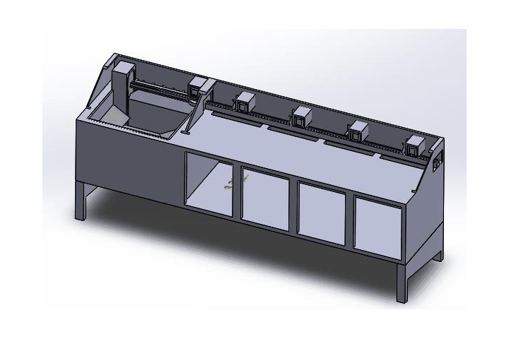
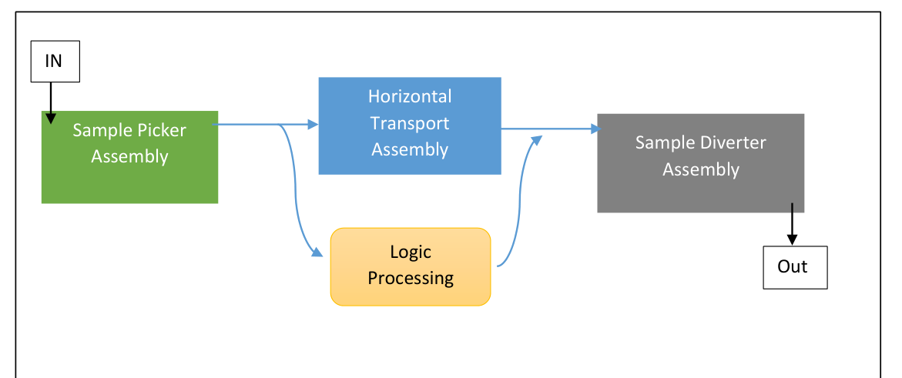
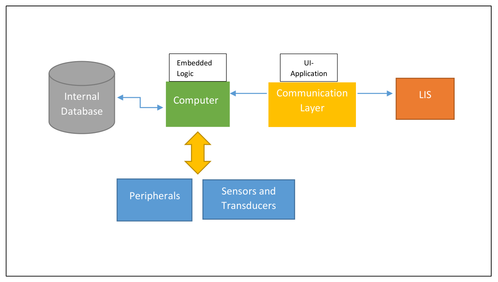

# Sample-Sorting Bulk Loader: Design Study

Project plan and concept design for an in-house **sample-sorting bulk loader**: a machine that takes a basket of blood-sample tubes, reads each barcode, checks its cap color, and drops it into the right bin for its lab section. Prepared in December 2021 for a diagnostics laboratory network, as the basis for developing lab instrumentation in-house rather than buying it.

## Goal

Build a modular, economical and robust bulk loader that reads standard sample tubes and sorts them, to cut turnaround time in the sample receiving and distribution area.

- **Primary users:** the network's own processing labs.
- **Secondary market:** other diagnostics labs.
- **Stakeholders:** purchasing, lab users, manufacturing partners and IT, which owns the integration with the lab information system (LIS).

## What the study covers

1. **A phased development plan:** planning, concept development, system-level design, detail design, testing with alpha and beta prototypes, and production ramp-up to the next five units.
2. **Customer needs and target specifications.** These include the throughput baseline measured on the sorter in use: about 9 s per tube, or roughly 1,200 tubes per hour.
3. **System architecture:** the hardware subsystems and the software and communication layers that connect the machine to the LIS.
4. **Two CAD concepts:**
   - **Concept 1, linear:** a vertical conveyor feeds a horizontal transport that runs past the barcode scanner and color sensor to four diverter-driven bins.
   - **Concept 2, rotary:** the horizontal run is cut short, and a rotary plate diverts each tube straight into a ring of bins. A camera with image processing replaces the color sensor. This shrinks the machine and the time each tube spends in it.
5. **Component selection and a bill of materials** for an alpha prototype of each concept.

| Hardware subsystems | Software layers |
| --- | --- |
|  |  |

## Documentation

The full design study is in [docs/design-study.md](docs/design-study.md).

Prepared with a colleague. CAD was built in SolidWorks. Pricing, vendor quotes and organization-specific details are left out of this public version.
