# The Bulk Loader: Project Planning and Design Study

*December 2021*

**Objective:** build a sample-sorting bulk loader with a barcode scanner and a software interface to the lab information system.

## 1. Development plan

The project follows a six-phase product development process: planning, concept development, system-level design, detail design, testing and refinement, and production ramp-up.

### Concept development

Identify the market's needs, then generate and evaluate alternative concepts and select one or more for further development and testing. Here, two directions were considered: matching the architecture of the sorter already in use, and redesigning it to create new IP.

### System-level design

Define the product architecture, break it into subsystems and components, and design the key components. Initial plans for production and final assembly are set here.

Here, once a concept is selected, this phase produces the functional designs, CAD models, process flow and a detailed description of each subcomponent, and finalizes the production plan. Test parameters for the alpha and beta prototypes, per subcomponent, follow from this phase.

### Detail design

Fully specify the geometry, materials and tolerances of every unique part, and set the process plan, covering material selection, production cost and robust performance.

Here, this phase produces the complete bill of materials with the exact make and model of each subcomponent, and finalizes the tooling and production process. The design is tested against performance targets and iterated until it meets the relevant standards. The final control documentation for the product and production line is released at the end of this phase.

### Testing and refinement

**Alpha prototype:** built from the parts finalized in detail design. The electronic and mechanical subcomponents are unit-tested, then integrated into the prototype. It is tested extensively against the predefined parameters, for usability and customer satisfaction, and in a live lab.

**Beta prototype:** built from the alpha results, with materials procured as for the final product but without an optimized production line. Performance and reliability are the main goals, and any final engineering changes happen here. The beta processes can be optimized into a final assembly line if mass production is needed.

### Production ramp-up

Build the next five loader modules with the intended production system, train the workforce and work out remaining production problems. The target is to assemble each later unit in at most half the time the beta prototype took, while monitoring the working units for further optimizations.

## 2. Concept development

### Mission statement

| | |
| --- | --- |
| **Product** | A modular, economical and robust bulk loader that reads a standard sample tube and sorts it |
| **Benefit** | Shorter turnaround time in the sample receiving and distribution area |
| **Business goal** | Much lower cost than buying commercial equipment |
| **Primary market** | The network's own lab facilities |
| **Secondary market** | Other diagnostics labs |
| **Stakeholders** | Purchasing, lab users, manufacturers, IT (LIS integration) |

### Customer needs

**Primary needs**
- Sort sample tubes at a set rate, as a cheaper alternative to equipment on the market.
- Accept tubes into an input section and sort each into its bin.
- Receive sorting rules from the LIS over LAN through the onboard controller, and report each sorted result back to the LIS.
- Pause whenever a bin is disturbed, and keep samples safe.

**Secondary needs**
- A buzzer or notification when a bin is close to full.
- An onboard display showing data-transfer activity, with search over its sample database and operation history.
- A storage bin for unregistered samples, so they can be rerun later.
- Image processing to check sample quality.
- Modular connections to other automation, such as a lab track or an automatic centrifuge.

### Target specifications

**Throughput baseline, measured on the sorter in use:**

| Stage | Time |
| --- | --- |
| Vertical assembly (tube lifted to the top) | 5.6 s |
| Horizontal assembly to the first bin | 2.6 s |
| Horizontal assembly to the fourth bin | 6.7 s |
| Total per tube | 8.2 s (min) to 11.6 s (max), about 9 s on average |

**Average throughput: about 20 tubes per minute, or 1,200 per hour.**

**Data still to be gathered:** required throughput (samples per day), average daily sample load across labs, average downtime of current equipment and its causes.

**Derived design parameters:** tube speed through the machine, barcode read time, maximum tube acceleration, and the size needed for each storage bin.

### System architecture

Tubes enter the **sample picker assembly**, travel through the **horizontal transport assembly** while the **logic processing** decides each tube's bin, and leave through the **sample diverter assembly**.

An embedded computer runs the machine logic, with an internal database, peripherals, and sensors and transducers. A communication layer and UI application connect it to the LIS.

## 3. Concept 1: linear bulk loader

### Components

**Sensors**

| Component | Qty | Location | Role |
| --- | --- | --- | --- |
| Barcode scanner | 1 | Horizontal | 3D scanner that reads and transmits each barcode within the read-time budget, over a serial link |
| Color sensor | 1 | Horizontal | Reads the cap color at a set distance; capture triggers a flash and an image |
| Proximity sensor | 1 | Vertical | Checks that a tube is in its holder (IR, 10–100 cm) |
| Limit switches or IR sensors | 8 + 1 | Bins, input | Detect a bin being opened, and a tube dropping in |
| Through-beam sensor | 1 | Horizontal | Triggers the color camera |
| Motor encoders | 2 | Vertical, horizontal | Track the conveyor position |
| Diverter position sensors | 4 | Horizontal | Confirm each diverter is in line (dropped in a later revision) |

**Actuators:** four stepper motors (NEMA 17 class) to divert tubes, one servo for the rotary mechanism, a vertical conveyor motor and a horizontal pulley motor.

**Computing:** a rear-mounted touch HMI, an embedded main computer (Jetson Nano or equivalent) and a motor driver.

**Mechanical:** a spring-loaded capture finger that lets only one tube into each holder, a pusher, a stationary filter that limits tube dimensions, housings for the diverter motors and rotors, the color sensor and the barcode scanner, a rotary table that turns each tube to face the color sensor after the barcode read, the conveyor and pulley assemblies, and moving sample holders that drop each tube into the horizontal assembly.

### Component selection notes

- **Barcode scanner:** an omnidirectional on-counter reader with a serial (RS-232) connection to the controller. Its read range is 0–17.7 cm and it tolerates 65° pitch and 75° yaw. Its scan rate sets the maximum tube speed past it, with a 50% safety margin.
- **Color sensor:** industrial and embedded RGB sensors were shortlisted.
- **Proximity sensors:** the sensors in the existing machine sense only 2–25 mm with a 0.5 ms response. They're very reliable but overpowered for this job, so one could be paired with cheaper redundant sensors.
- **HMI:** a 4.3-inch embedded touch panel with Ethernet, serial and CAN options, which can connect to the instrument directly over LAN.
- **Diverter position sensors:** small slot-type photoelectric sensors.
- **Through-beam trigger:** the existing wide-beam fiber sensor is far beyond what's needed, and a much cheaper part would do.
- **Main computer:** a Jetson Nano module (quad-core ARM, 128-core GPU, 4 GB RAM, gigabit Ethernet). It leaves room for advanced techniques such as image processing.
- **Stepper motors:** NEMA 17 with 4.2 kg·cm holding torque and a 1.8° step, which is adequate, pending further technical checks.

### CAD design

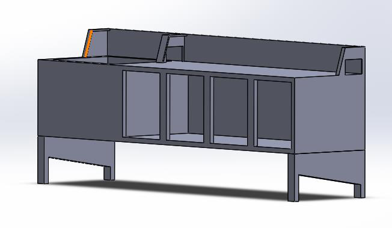

The chassis is the machine's skeleton: laser-cut sheet steel, riveted or bolted.

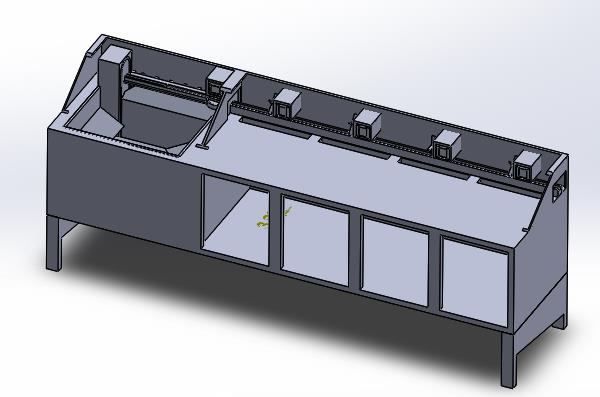

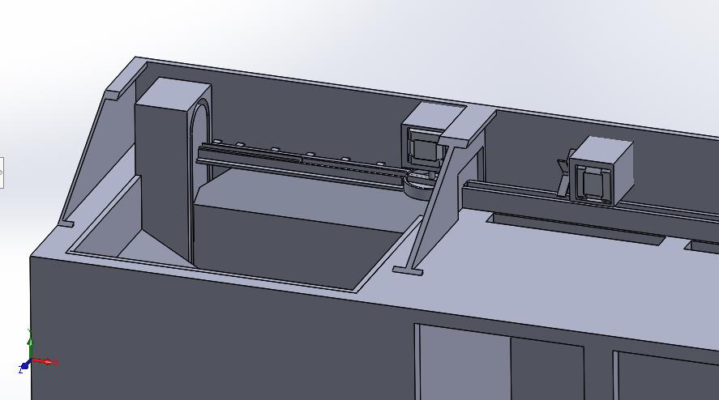

| Input basket | Overview |
| --- | --- |
| 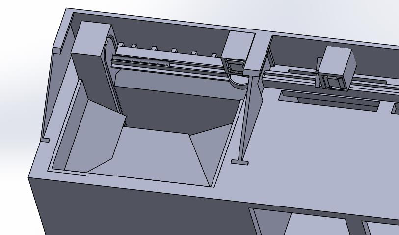 | 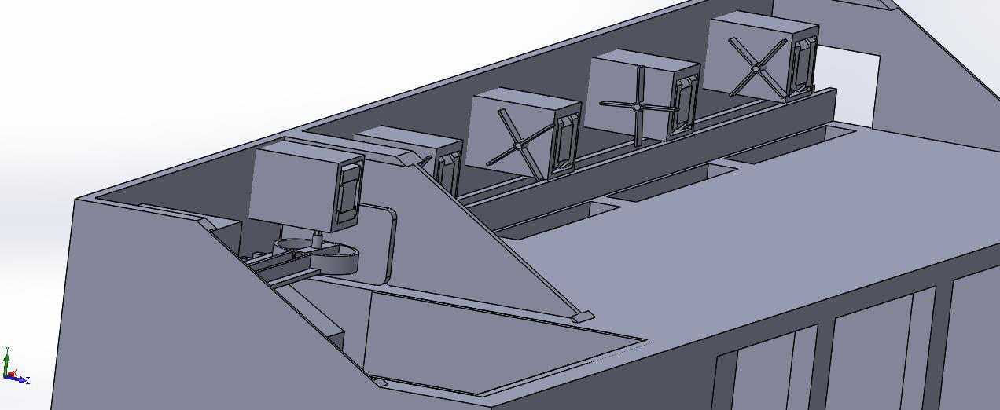 |

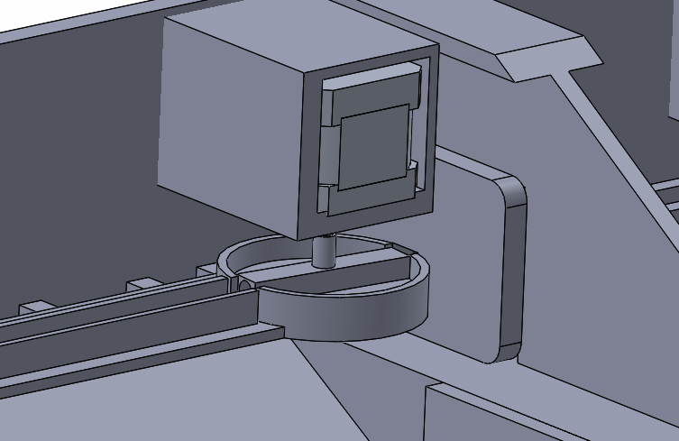

**Summary:** Concept 1 keeps the proven architecture of the existing sorter, with identical vertical and horizontal assemblies, but upgrades its processors and sensors. The existing product already validates this architecture.

## 4. Concept 2: rotary bulk loader

| Isometric view | Front view |
| --- | --- |
| 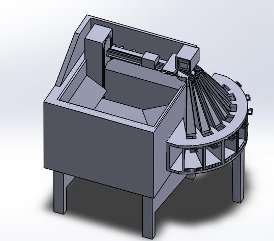 | 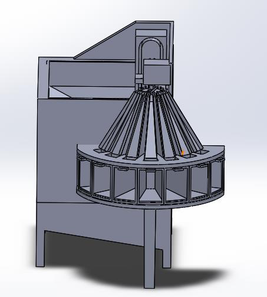 |

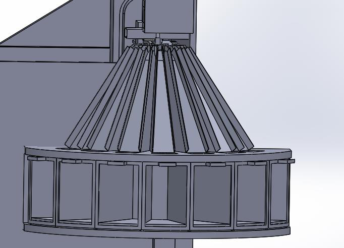

| Horizontal assembly | Circular pusher |
| --- | --- |
| 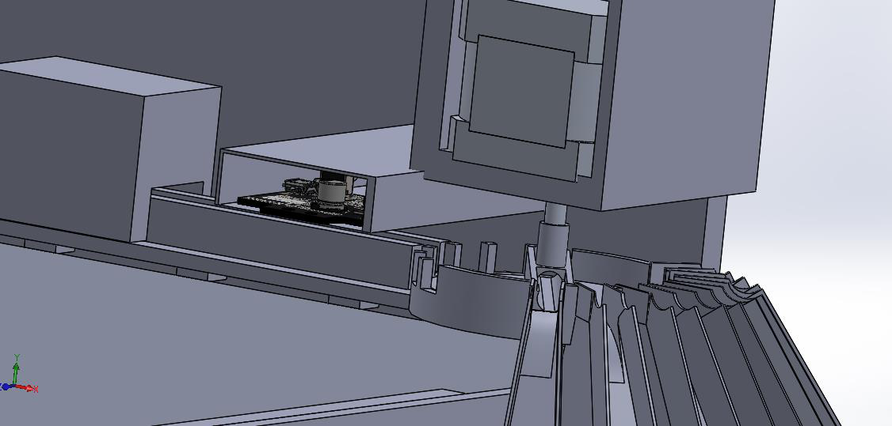 | 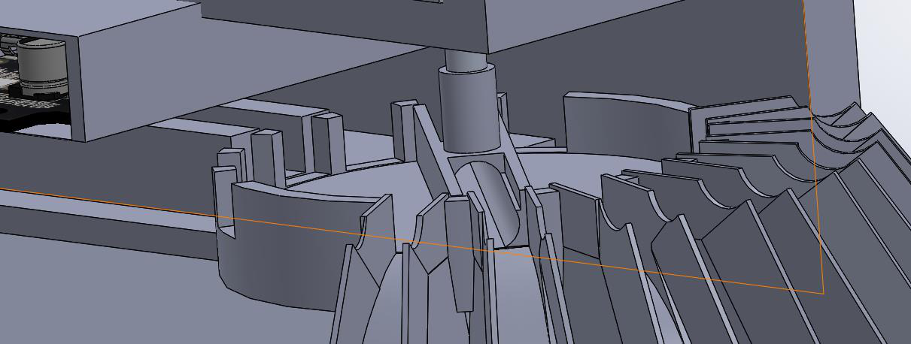 |

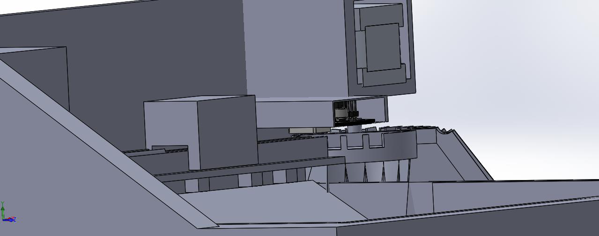

**What changes from Concept 1:**
- **The long horizontal assembly is cut short.** The rotary plate that oriented each tube now diverts it directly into its bin. This shrinks the machine and the time a tube takes to cross it.
- **The bins are arranged in a ring** around the rotary plate.
- **A camera with image processing replaces the color sensor** (a Pixy-class vision module). Cap color can be detected with a trained model or with a manual trigger and classic image processing.

The extra camera adds only slightly to the bill of materials, and Concept 2 removes four diverter motors.
